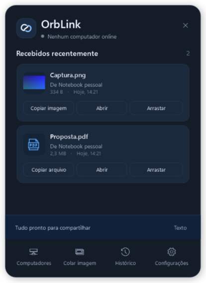
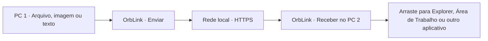

# OrbLink

<p align="center"><strong>Arraste. Solte. Receba.</strong><br>Transfira arquivos, imagens e textos entre computadores Windows pela rede local, sem nuvem obrigatória.</p>

<p align="center">
  <a href="https://github.com/dhenisson/OrbLink/releases/download/v0.3.0-beta/OrbLink-win-x64-v0.3.0.zip"></a>
  <a href="https://github.com/dhenisson/OrbLink/releases/tag/v0.3.0-beta"></a>
  <a href="LICENSE"></a>
</p>

<p align="center"><strong><a href="https://github.com/dhenisson/OrbLink/releases/download/v0.3.0-beta/OrbLink-win-x64-v0.3.0.zip">⬇ DOWNLOAD DIRETO — ORBLINK PARA WINDOWS</a></strong></p>
<p align="center"><a href="#português">Português</a> · <a href="#english">English</a> · <a href="https://github.com/dhenisson/OrbLink/releases">Todas as versões / All releases</a></p>



*Captura do aplicativo com dados sintéticos. Nenhum dado pessoal real está representado.*

---

## Português

### O que é o OrbLink?

O **OrbLink** é um aplicativo gratuito e open source para **Windows x64** que permite transferir arquivos, imagens e textos diretamente entre computadores conectados à mesma rede local. Em vez de usar e-mail ou nuvem, você arrasta o conteúdo para uma pequena **orb flutuante** e recebe no outro computador.

### Como funciona



1. Abra o OrbLink nos dois PCs.
2. Vá em **Computadores**, encontre o outro PC e solicite o pareamento; confirme no destinatário.
3. Arraste um arquivo para a orb (ou use as opções de imagem/texto no painel).
4. No PC receptor, arraste o arquivo recebido para o destino desejado. Aplicativos externos precisam aceitar o drag-and-drop de arquivos do Windows.

### Instalação — Windows

1. **[Baixe o OrbLink v0.3.0 Beta (ZIP para Windows x64)](https://github.com/dhenisson/OrbLink/releases/download/v0.3.0-beta/OrbLink-win-x64-v0.3.0.zip)**.
2. Extraia o ZIP em uma pasta estável.
3. Abra **`OrbLink.exe`**. O runtime necessário acompanha o pacote; você não precisa instalar o SDK .NET.
4. Repita nos dois PCs e permita comunicação **somente na rede privada confiável**.

**Verificação do download:** [SHA-256 oficial](https://github.com/dhenisson/OrbLink/releases/download/v0.3.0-beta/SHA256SUMS-v0.3.0.txt). O executável ainda não possui assinatura digital e pode gerar alerta do SmartScreen. Confira a origem e o hash; não desative proteções do Windows.

### Recursos

- Transferência de arquivos por HTTPS na LAN, com confirmação de pareamento.
- Orb flutuante com posição ajustável, transparência e suporte a vários monitores.
- Arrastar e soltar arquivos para envio e do painel recebido para aplicativos compatíveis.
- Envio de texto e imagens, incluindo **Ctrl+V** de imagens com o painel ativo.
- Progresso da transferência, histórico local e verificação de integridade.
- Código-fonte aberto sob licença MIT.

**Limitações da beta:** não há nuvem, atualização automática ou retomada automática de arquivos interrompidos. A escolha do destinatário é limitada quando vários computadores estão online. Testes manuais adicionais com dois computadores e apps externos ainda são recomendados.

### Segurança e compatibilidade

Use apenas em redes confiáveis; **não exponha a porta do aplicativo à internet**. Os arquivos recebidos ficam armazenados no perfil do Windows e não são executados automaticamente. A segurança do primeiro pareamento depende da confiança na rede e da confirmação do usuário. Leia [SECURITY.md](SECURITY.md) e [auditoria técnica](docs/SECURITY-AUDIT.md).

**Atualizando de uma versão antiga:** preserve os dados de pareamento em `%LOCALAPPDATA%\AMS Transfer` para manter a compatibilidade com os PCs já conectados. Esse nome legado de armazenamento é intencional.

---

## English

### What is OrbLink?

**OrbLink** is a free, open-source **Windows x64** app for transferring files, images, and text directly between computers on a local network. Its small **floating orb** makes sending and receiving content feel like moving it between desktops—without requiring cloud storage.

### How to install

1. **[Download OrbLink v0.3.0 Beta for Windows x64 (ZIP)](https://github.com/dhenisson/OrbLink/releases/download/v0.3.0-beta/OrbLink-win-x64-v0.3.0.zip)**.
2. Extract the ZIP to a stable folder.
3. Run **`OrbLink.exe`**. The required runtime is included.
4. Repeat on both Windows PCs, then pair them via **Computers**. Allow network access only on trusted private networks.

### How to use

Drag a file onto the floating orb on the sending PC. The receiving PC stores a local copy; drag it from the OrbLink panel into File Explorer, Desktop, or another application that supports Windows file drag-and-drop. The panel also supports sending text and pasting images with **Ctrl+V**.

**Beta limitations:** no cloud sync, automatic updater, or transfer resume. Explicit destination selection for multiple online peers is not yet available. Further real-world testing is recommended.

**Security:** OrbLink uses HTTPS over the LAN and approval-based pairing, but the initial pairing assumes a trusted network. Never expose its listening port to the public internet. Downloaded builds are unsigned: [verify the SHA-256](https://github.com/dhenisson/OrbLink/releases/download/v0.3.0-beta/SHA256SUMS-v0.3.0.txt). See [SECURITY.md](SECURITY.md).

---

## Desenvolvimento / Development

Requisitos para compilar: Windows, SDK .NET 10 indicado em [global.json](global.json), PowerShell e Git.

```powershell
dotnet restore OrbLink.slnx
dotnet build OrbLink.slnx -c Release
dotnet test OrbLink.slnx -c Release
dotnet run --project src/OrbLink.App/OrbLink.App.csproj
```

Para gerar a distribuição Windows e os ZIPs, use:

```powershell
.\scripts\build.ps1
.\scripts\package.ps1
```

Documentação técnica / Technical docs: [Architecture](docs/ARCHITECTURE.md) · [Development](docs/DEVELOPMENT.md) · [API](docs/API.md) · [Testing](docs/TESTING.md).

## Contribua / Contribute

Contribuições e relatos de bugs são bem-vindos. Leia [CONTRIBUTING.md](CONTRIBUTING.md) antes de abrir um pull request. Use dados sintéticos em relatórios e capturas. / Contributions and bug reports are welcome; please read the contributing guide.

## Roadmap

- Validação em mais PCs, redes e escalas DPI / Additional real-world testing.
- Instalador e assinatura digital / Installer and code signing.
- Código de comparação para o primeiro pareamento / Out-of-band pairing confirmation.
- Escolha explícita de computador de destino / Destination picker.
- Fila e retomada de transferências / Transfer queue and resume.

## Licença / License

**MIT License** — Copyright © 2026 **Dhenisson de Jesus Goncalves**. Veja [LICENSE](LICENSE), [THIRD-PARTY-NOTICES.md](THIRD-PARTY-NOTICES.md) e [CHANGELOG.md](CHANGELOG.md).
